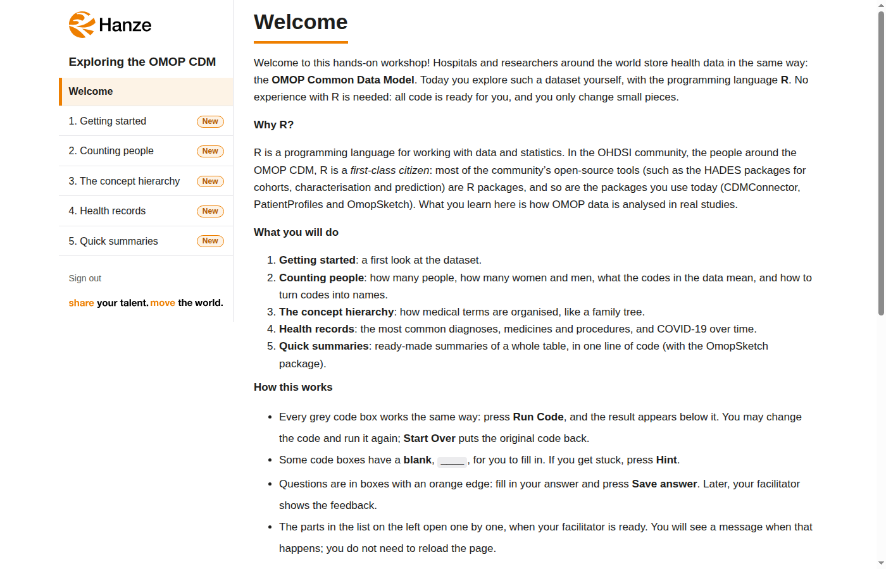
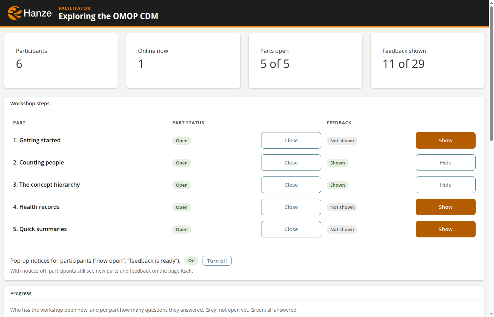

# A hands-on OMOP CDM workshop in R

<p>
  
  
</p>
<p><em>Left: what participants see. Right: the facilitator's page.</em></p>

Participants work through a **learnr tutorial** in their browser: explanations, editable R code boxes with
**Run Code**, and questions. The **facilitator** decides when each section opens and when feedback is shown;
participants' pages follow within a few seconds, without reloading. Everything is R, and everything runs in
containers.

The first workshop is `omop_explore`: exploring a synthetic COVID-19 OMOP CDM (synthea-covid19-10k) with dplyr,
CDMConnector, PatientProfiles and OmopSketch.

We have run `omop_explore` with 15 participants on a single VM (8 cores, 32 GB memory) and everything went
smoothly. It works well for people who are new to both R and OMOP. We gave a one-hour presentation first; the
workshop itself then took about an hour.

## Where to find things

| You want to change... | Look in |
|---|---|
| The workshop text, code boxes and question placement | `workshops/<name>/tutorial.Rmd` |
| The questions (wording, options) | `workshops/<name>/questions.yml` |
| The right answers and feedback texts | `workshops/<name>/key.yml` (never shown to participants) |
| How the participant page looks and behaves | `app/tutorial.R` |
| The facilitator page | `app/facilitator.R` |
| The rules (gating, saving, feedback) and the api | `app/core.R`, `app/api.R` |
| Who takes part, the address, ports and HTTPS | `config.yml` (copy `config.example.yml`; not in git) |
| Setting up the server (clean Ubuntu VM) | `SERVER.md`, step by step |
| Participants, passwords, ShinyProxy settings | `app/setup.R` (run with `./ws setup`) |
| The data set | `app/prepare_data.R` (run with `./ws prepare-data`) |
| Login page, the container image, server install script | `server/` (`login-pages/`, `Dockerfile`, `install-ubuntu.sh`) |
| Logos | `branding/` |
| Tests | `tests/` (`./ws test`, `./ws e2e`) |
| Everything a run creates: state, passwords, data, backups | `run/` (not in git) |

The one command for everything is `./ws` (see below).

## How it fits together

```
browser ─https─> caddy ─> shinyproxy ──> tutorial container, one per participant (learnr, R, OMOP packages)
                              │            reads: run/data (shared DuckDB, read-only), its own token
                              └──────────> facilitator container (admin only)
                                                 │                      │
                                                 └────> api <───────────┘
                                                  (R plumber: state + answer key)
```

| Part | What it does | Where |
|---|---|---|
| **api** | The only service with the answer key and the state (SQLite). Validates and saves answers, refuses them while a section is closed, returns feedback only once released. Decides everything from the caller's token. | `app/api.R`, `app/core.R` |
| **tutorial** | The participant's page: a learnr tutorial. One container per participant, started by ShinyProxy at login. | `workshops/<name>/tutorial.Rmd`, `app/tutorial.R` |
| **facilitator** | Open and close sections, release feedback (to everyone or one person), follow progress and answers. | `app/facilitator.R` |
| **ShinyProxy** | Logins (username + password), starts and stops the containers. | `run/shinyproxy/application.yml` (written by setup) |
| **Caddy** | HTTPS on the server, on the ports from `config.yml`. | `run/caddy/Caddyfile` (written by `./ws`) |

One image (`server/Dockerfile`) holds R and all packages, and serves every role. The answer key is **not** in
the image: it is mounted into the api only.

## Look and feel

Participants are not technical, so the pages are kept simple: plain language, one obvious action per step
(**Run Code**, **Save answer**), and nothing that can lose their work.

- **Login page and signed-out page:** `server/login-pages/` (setup copies them to `run/shinyproxy/templates/` with
  the logo embedded). ShinyProxy's own navigation bar is hidden; the tutorial has a **Sign out** link.
- **Participant page:** learnr, restyled in `app/tutorial.R` (`WS_CSS`, `WS_JS`). The sidebar shows per part: 🔒 not open
  yet, **New** (opened but not visited), ✓ (all questions saved). When a part opens or feedback is shown, a notice
  with **Go there** appears (the facilitator can turn these pop-ups off). learnr's sidebar "Start Over" (which erases
  all work) is removed. **Enter** saves an answer (Shift+Enter for a new line in a text answer). Results that are
  tables show every column in a box that scrolls (`ws_print_table()`), instead of learnr's paged table.
- **Facilitator page:** `app/facilitator.R`, bslib, one column (works on half a screen). One row per part with
  **Open part** / **Show feedback** buttons, a switch for participants' pop-up notices, a progress grid, and answers
  per part with **Show on screen** for the projector. Every piece (a count, a part's row, a participant's row, a
  question) is redrawn only when its own content changed, so the page does not flash. (Releasing to one participant is supported by the api, but
  has no button on the page.)
- **Colours:** the Hanze palette (brand portal); the CSS variables at the top of `WS_CSS` and the `bs_theme()` in
  the facilitator app. Buttons are white on a darker Hanze orange (`#B35C00`): white on `#EE7F00` itself is too low
  in contrast to read. Bright orange is for borders and accents.
- **Logos** in `branding/`: `hanze-logo.svg` (light backgrounds), `hanze-logo-dark.svg` (dark backgrounds, used in
  the facilitator header), `hanze-payoff.svg` ("share your talent. move the world.", login page and sidebar).

## A workshop is three files

`workshops/<name>/`:

| File | Who sees it | Contents |
|---|---|---|
| `questions.yml` | everyone (it is in the image) | sections (`id`, `title`, `gated`), questions (`id`, `section`, `type`: number, choice or text, `prompt`, `options`, `unit`) |
| `key.yml` | the api only | per choice option `[right/wrong/info, feedback]`; per number `expected`, `tolerance`, `ok`, `bad`; per question an optional `explain` |
| `tutorial.Rmd` | everyone | the learnr tutorial (see below) |

The api checks at startup that the key matches the questions, and stops with a list of problems if not.

When the facilitator shows feedback, everyone gets it: right or wrong for their answer plus the `explain` text,
and "Not answered" plus the `explain` text for those who did not answer.

In `tutorial.Rmd`:
- Each section is a `##` heading. A gated section's content is wrapped in
  `::: {.ws-section data-section="<section id>"}` … `:::`. Until the facilitator opens it, participants see
  "This section opens when your facilitator is ready" in its place.
- `ws_question("<question id>")` in a chunk shows a question. Inputs start empty: nothing is pre-filled or
  pre-selected.
- Fill-in exercises: put `____` where participants should type, and add a `<label>-hint` chunk with the complete
  code (learnr shows it under **Hints**; running code that still has a blank gives a friendly message).
- Code examples are learnr exercise chunks (`exercise=TRUE`). The global `setup` chunk connects to the data
  once per container; every exercise sees `cdm`. Objects created in one exercise are not kept for the next.
- Locked content is hidden, not absent: someone opening the browser's developer tools can read it. The answer
  key is never on the page.

## Running it

Everything goes through `./ws`. It uses Docker if a Docker daemon is running, otherwise rootless podman (it
starts podman's API socket, which ShinyProxy needs). In a toolbox, it runs itself on the host.

```bash
cp config.example.yml config.yml   # then edit: participants, address, ports (each setting is explained in the file)
./ws build              # the image: R, packages, the tutorial (first time ~10 min)
./ws prepare-data       # run/data/synthea-covid19-10k.duckdb, once (needs ~13 GB RAM; or copy the file in)
./ws setup              # accounts for the participants in config.yml + admin; login cards in run/handouts/
./ws up                 # prints the address (without an address in config.yml: http://127.0.0.1:8080)
./ws test               # api/core tests
```

- Log in as `admin` (password in `run/handouts/admin.txt`) for the facilitator page, and with a participant's
  username and password (their card in `run/handouts/`) for the tutorial.
- **Who takes part:** the `participants:` list in `config.yml`, one name per line; the username is made from the
  name ("Ana de Vries" becomes `ana-de-vries`), or choose it with `- Ana de Vries: ana`. Read when participants are
  created (the first `./ws setup`, or `--fresh`; `--add` adds newcomers). Without a list: `wp01`..`wp15`. For tests: `--participants 3` or
  `--ids ana,ben`. Setup writes printable login cards with the address to `run/handouts/all.html`.
- `./ws setup --add`: add the people in `config.yml` who have no account yet (everyone else keeps their account and
  answers), or one person: `./ws setup --add "Ana de Vries"` (or `"Ana de Vries: ana"`). Their login card is in
  `run/handouts/`. ShinyProxy restarts to load the new account: participants who have the workshop open see a
  message to reload the page (their answers and code are kept).
- `./ws setup --reset`: keep participants and passwords, clear answers and releases (backup in `run/backups/`).
- `./ws setup --fresh`: move state, tokens, passwords and config to `run/backups/<time>/` and start over.
- `./ws setup --config`: rewrite only the ShinyProxy configuration (after changing the variables below).
- After changing the tutorial, questions or R code: `./ws build`, then `./ws up` (running participants get the
  new version when their container restarts). After changing `key.yml`: `./ws up` restarts the api.

Limits per participant are in `config.yml`: `memory` (default `2g`), `cpus` (default `2`) and `idle_minutes` (stop
a participant's session this long after their tab closed; default 30). After changing them: `./ws setup --config` and
`./ws up`. A participant who comes back gets a new session in a few seconds; their answers are on the server and
their code boxes are restored by the browser.

### On the server

See **`SERVER.md`**: from a clean Ubuntu VM to a running workshop, step by step. In short: `server/install-ubuntu.sh`
(Docker), `./ws build`, the dataset, `config.yml` (participants, `address: auto`, ports, `tls: auto`),
`./ws setup`, `./ws up`. Participants open `https://<ip-with-dashes>.sslip.io` (on the ports from `config.yml`);
Caddy gets the certificate from Let's Encrypt, or uses one in `/etc/letsencrypt` (`tls: files`).

## Security model (what to know)

- **The key stays in the api.** Participants' containers have the questions and the tutorial, never verdicts,
  expected values or feedback. Feedback is sent only after release, and only for the participant's own answers.
- **Identity is a token per participant**, mounted read-only into that participant's container only. The api
  stores only token hashes. The facilitator app has an admin token.
- **Participants run R code in their own container**, with a memory and CPU limit, as an unprivileged user.
  The containers share one network with the api, so participant code could call the api directly or reach
  another participant's tutorial port. The api accepts only what that participant could do anyway; reaching
  another person's tutorial page is possible for someone who tries. Acceptable for a known group; not for
  an anonymous public.
- **Passwords** are stored in plain text in `run/state/users.yml` and `run/shinyproxy/application.yml`
  (ShinyProxy's simple login requires that). Both are mode 600; keep `run/` private.
- Numeric checks can be found by trying values: keep checks low-stakes.

## Use of AI

This project was developed with the help of generative AI. Most of the code (R, Shiny, shell, container
configuration), the tests and the documentation were written with Claude (Anthropic), used as a coding assistant
in Claude Code. The authors decided what to build, designed the workshop and its teaching approach, directed and
reviewed the work, tested it, and run the workshop. The tutorial texts and questions were drafted with AI
assistance and revised by the authors. The authors are responsible for the content.

An AI tool cannot be responsible for what it produces, so it is not named as an author or co-author anywhere in
this repository: commits carry no AI attribution lines. This statement is the disclosure, for all of the work.

No AI runs in the workshop itself: participants' code and answers are not sent to any AI service. No participant
data was shared with an AI tool during development; the dataset is synthetic (Synthea).

## Licence and citation

© 2026 Steven Warmelink and Sophie de Klerk, Hanze University of Applied Sciences.

- **Code** (everything except the two folders below): the **MIT** licence; see `LICENSE`.
- **Workshop content** (`workshops/`: the tutorial, questions, answer key and the pictures drawn for it): the
  **Creative Commons Attribution-ShareAlike 4.0 International** licence (CC BY-SA 4.0); see `LICENSE-CONTENT`.
  The sources and licences of the pictures are in `workshops/omop_explore/images/ATTRIBUTION.md` (the OMOP CDM
  diagram is CC0, from *The Book of OHDSI*).
- `branding/`: the Hanze logos and payoff are trademarks of Hanze University of Applied Sciences and are **not**
  covered by either licence. Replace them with your own when you reuse this work.
- The dataset (synthea-covid19-10k) is not part of this repository; `./ws prepare-data` downloads it.

To cite this work, see `CITATION.cff` (GitHub shows it as "Cite this repository"). `.zenodo.json` holds the
metadata for a Zenodo release (DOI).
